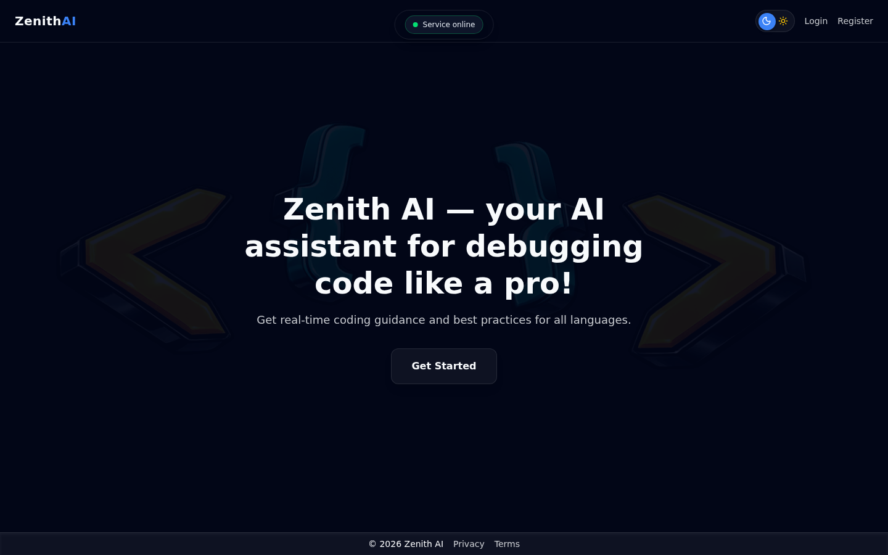
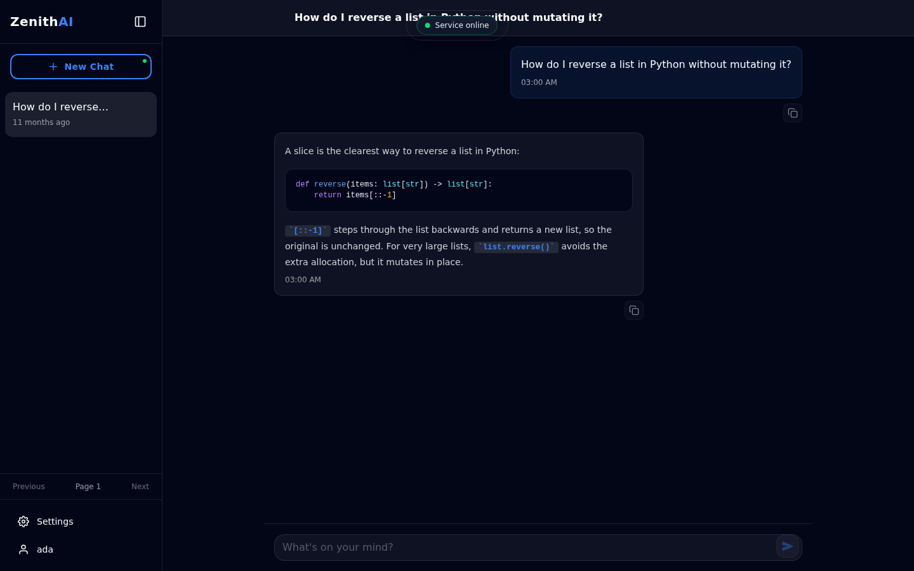
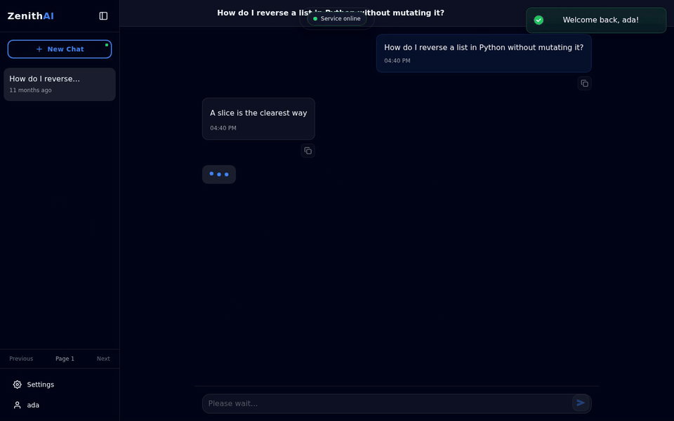

# Zenith AI — Frontend

[](https://github.com/DavFilsDev/zenithAI_react-typescript-frontend/actions/workflows/ci.yml)

React frontend for Zenith AI: a free, open-to-everyone AI chat application with no credits, no premium tier, and no payment.

Target infrastructure cost: **0 €**. Only free technologies and free services are used.

- Backend repository: `zenithAI_django-backend`, served on `http://localhost:8000` in development
- Frontend: `http://localhost:5173` in development
- Shared API contract: [`docs/API_CONTRACT.md`](docs/API_CONTRACT.md)

## Status

The application is functional and hardened through the security and accessibility work. It is honest about the gap between what it does and what the contract describes, and the gap is tracked rather than hidden.

**Implemented today:**

- Public landing page, login and registration
- JWT sign-in, session restore on reload, sign-out
- Conversation creation, list, rename, deletion and pagination
- Streaming SSE answers rendered token by token
- Profile editing
- GFM tables, sanitized markdown and highlighted code blocks
- Access token in memory, refresh token in `sessionStorage`, and a CSP
- Keyboard navigation, dialog focus handling, live regions and reduced motion
- Backend health indicator with a cold-start message
- Privacy and terms pages
- Dark and light theme, persisted
- Responsive layout with a collapsible sidebar
- Vitest, Testing Library, MSW and Playwright coverage for the main flows
- GitHub Actions CI and Vercel deployment configuration

**Still pending:**

- **Vercel project connection and production URL.** The repository is configured in
  `vercel.json`; the URL is added after the first deploy.
- **A showcase recording from the deployed instance.** Local screenshots,
  recording and technical decisions are in the showcase section below; they are
  refreshed after the first deploy.

## Stack

|               |                                                                    |
| ------------- | ------------------------------------------------------------------ |
| Framework     | React 19, with React Router 7                                      |
| Language      | TypeScript 5.9                                                     |
| Build tool    | Vite 7                                                             |
| Styling       | Tailwind CSS 4, configured in CSS                                  |
| Server state  | TanStack Query                                                     |
| UI state      | Zustand for the session and chat UI, a React context for the theme |
| HTTP client   | Axios for JSON, `fetch` for the SSE stream                         |
| Forms         | React Hook Form                                                    |
| Markdown      | react-markdown, remark-gfm, rehype-sanitize, rehype-highlight      |
| Notifications | react-hot-toast                                                    |
| Icons         | lucide-react                                                       |
| Testing       | Vitest, Testing Library, MSW and Playwright                        |

Not installed, and therefore not used: Prism, CSS Modules, any WebSocket library.

## Requirements

- Node.js 20.19 or newer
- npm
- The backend running on `http://localhost:8000` for development
- Chromium for Playwright, installed once with `npx playwright install chromium`

## Local setup

```bash
git clone https://github.com/DavFilsDev/zenithAI_react-typescript-frontend.git
cd zenithAI_react-typescript-frontend

npm install

cp .env.example .env.local
```

Edit `.env.local` if your backend is not on the default port, then start the dev server:

```bash
npm run dev
```

The frontend is on <http://localhost:5173>, the backend on <http://localhost:8000>. The backend must allow this origin, which in development is `CORS_ALLOWED_ORIGINS=http://localhost:5173`.

## Environment variables

`.env.example` lists every variable the project declares.

| Variable             | Value                          | Read by                                       |
| -------------------- | ------------------------------ | --------------------------------------------- |
| `VITE_API_URL`       | `http://localhost:8000/api/v1` | The Axios instance and the token refresh call |
| `VITE_APP_NAME`      | `Zenith AI`                    | The document title                            |
| `VITE_DEFAULT_THEME` | `dark`                         | The theme applied before first paint          |

Only `VITE_API_URL` affects where requests go. All three are validated at startup with `zod`: a missing or malformed value stops the app with a message naming the variable. `VITE_APP_NAME` sets the document title and `VITE_DEFAULT_THEME` sets the theme applied before the first paint; a theme saved in `localStorage` still wins over the default.

On Vercel, `VITE_*` values are inlined at build time, so a different `VITE_API_URL` means a different build. Set all three variables in **Project Settings → Environment Variables** for Production and Preview, and set them again for preview deployments if they should use a different backend.

## Scripts

These scripts exist today:

```bash
npm run dev                   # dev server on port 5173, opens a browser
npm run build                 # production build into dist/
npm run preview               # serve the production build locally
npm run lint                  # ESLint
npm run type-check            # TypeScript
npm run format                # rewrite the tree with Prettier
npm run format:check          # fail if the tree is not formatted
npm run test                  # Vitest, once
npm run test:coverage         # Vitest with the coverage gate
npm run test:e2e              # Playwright, starts Vite itself
npm run generate:api-types    # regenerate src/shared/api/api.generated.ts from the backend schema
npm run generate:msw-handlers # regenerate the MSW handlers from the vendored schema
```

`test:e2e` starts Vite on `127.0.0.1:5173` with `BROWSER=none`, uses Chromium, and intercepts `/api/v1` at the browser boundary. The journeys do not need the backend or an LLM key.

## Quality gates

Run these before committing:

```bash
npm run format:check
npm run type-check
npm run lint
npm run check:design
npm run test:coverage
npm run test:e2e
npm run build
```

`type-check` and `build` share the same `tsc -b` gate with `strict`, `noUncheckedIndexedAccess` and `exactOptionalPropertyTypes`. `lint` runs the flat ESLint config with type-aware `typescript-eslint` rules, including `no-floating-promises` and `no-misused-promises`, plus the `jsx-a11y` recommended set, and `--max-warnings 0`. `test:coverage` enforces the 80% threshold on `features/` and `shared/api/`. `check:design` enforces the Design.md banned-pattern guard in source files. Accessibility, visual consistency, and responsive behavior are covered by lint rules, component tests, and Playwright suites using axe, screenshot baselines, and width assertions.

Visual baselines live in `e2e/visual.spec.ts-snapshots/`. Review changed images deliberately, then regenerate them with `npx playwright test e2e/visual.spec.ts --update-snapshots` and commit the result in the same change as the visual decision.

`lint-staged` runs ESLint and `tsc -b` on staged TS/TSX files, and Prettier on the rest, so a commit cannot carry a type or lint error.

## Deployment (Vercel)

The frontend is a static single-page application. [`vercel.json`](vercel.json) sets the install command, the build command, the output directory, the SPA rewrite and the security headers. `package.json` pins Node 22.

| Setting         | Value                                    |
| --------------- | ---------------------------------------- |
| Framework       | Vite                                     |
| Install command | `npm ci`                                 |
| Build command   | `npm run build`                          |
| Output          | `dist`                                   |
| Node            | `22.x`                                   |
| SPA rewrite     | `/(.*)` → `/index.html`                  |
| Security        | `vercel.json` headers applied to `/(.*)` |

1. Import this repository into Vercel with the repository root as the project root.
2. Select the Vite preset and keep the values above.
3. Set `VITE_API_URL`, `VITE_APP_NAME` and `VITE_DEFAULT_THEME` in **Project Settings → Environment Variables** for Production and Preview.
4. Add the Vercel origin to the backend's `CORS_ALLOWED_ORIGINS`.
5. Deploy. Vite inlines the variables at build time, so changing them requires a redeploy.
6. Open a deep link such as `/chat` to confirm the rewrite returns the app instead of a 404.

The production API must use HTTPS: the Vercel header policy allows `connect-src 'self' https:`. The Vite-generated meta policy uses the exact API origin for local and preview builds. Do not proxy `/api/*` through a Vercel Function, because the SSE stream needs a long-lived response.

Production URL: _pending the first Vercel deploy._

## Continuous integration

[`.github/workflows/ci.yml`](.github/workflows/ci.yml) runs on pull requests and on pushes to `main`:

- **Quality** — `format:check`, `lint`, `type-check`, `test:coverage` and `build`
- **Playwright** — installs Chromium and runs the browser journeys, uploading the report when a journey fails

Enable the workflow as a required status check in the branch protection rules so a pull request with a failing gate cannot be merged.

## Showcase







The screenshots and recording are generated from the local application with a mocked API. The recording uses the same SSE event shape the Playwright journey exercises.

### Technical decisions

- **Access in memory, refresh in `sessionStorage`.** The access token never touches persistent storage; the refresh token survives a reload and dies with the tab.
- **Sanitized markdown.** Assistant answers pass through `rehype-sanitize` before highlighting, and unsafe link protocols are dropped.
- **CSP in two places.** A meta tag covers static hosts that cannot set headers; `vercel.json` sets the real policy where Vercel serves the file.
- **Server state in TanStack Query, streaming in one adapter.** The SSE reader appends into the query cache, so a re-render cannot lose a fragment.
- **Free-tier UX is explicit.** The health indicator says when the backend is starting, rate limits say when to retry, and nothing offers a purchase.
- **Startup cost is bounded.** Routes are lazy, the auth bootstrap is deferred until a session exists, and the background is a responsive WebP pair.

## Project structure

```
src/
├── main.tsx         entry point
├── index.css        the only stylesheet
├── assets/
├── app/             providers, router, ChatShell, ProfileBootstrap
├── features/
│   ├── auth/        api, model, pages, components
│   ├── chat/        api, model, pages, components
│   ├── home/        pages, components
│   ├── legal/       privacy and terms pages
│   └── status/      health query and service indicator
├── shared/
│   ├── api/         client, interceptor, errors, env, tokens, generated types
│   ├── auth/        session store and useSession
│   ├── ui/          Button, Input, theme, toasts, Spinner
│   ├── hooks/       useOnClickOutside
│   └── lib/         logger, parseRetryAfter
└── test/            MSW server, generated handlers, render helpers
public/              favicon, background images
e2e/                 Playwright journeys and the browser API mock
docs/                architecture, contract, roadmap and showcase assets
.github/workflows/   CI pipeline
vercel.json          build, output, SPA rewrite and security headers
```

Unit tests sit next to their subject. Shared test support is in `src/test/`, and browser journeys are in `e2e/` with their API mock in `e2e/support/`. The full tree and the layer rules are in [`docs/ARCHITECTURE.md`](docs/ARCHITECTURE.md).

## Known issues

- The Vercel project is not connected yet, so the production URL is still pending.
- `npm audit` reports 32 advisories (8 low, 12 moderate, 12 high) from the current dependency tree.
- The Vercel CSP allows `connect-src 'self' https:`, so the production API must be served over HTTPS.

## Status & Roadmap

Phases, with effort, acceptance criteria and dependencies, are in [`docs/IMPROVEMENT_PLAN.md`](docs/IMPROVEMENT_PLAN.md).

| Phase | Scope                                                                                                  |
| ----- | ------------------------------------------------------------------------------------------------------ |
| P0    | Consistency with the contract: base URL, conversation paths, environment validation, dead code removal |
| P1    | The API layer: profile editing, single-flight refresh, real logout, generated types, rate-limit UX     |
| P2    | Streaming over SSE, TanStack Query for server state, the feature-based structure                       |
| P3    | Quality: a type-check that works, stricter linting, Prettier, husky, Vitest, Playwright                |
| P4    | Security and accessibility: sanitization, token storage, keyboard access, dialogs, Lighthouse          |
| P5    | Continuous integration, free deployment, and a showcase                                                |

- [`docs/IMPROVEMENT_PLAN.md`](docs/IMPROVEMENT_PLAN.md) — audit findings, roadmap, token storage, free hosting, zero-cost rules
- [`docs/API_CONTRACT.md`](docs/API_CONTRACT.md) — the API contract shared with the backend repository
- [`docs/ARCHITECTURE.md`](docs/ARCHITECTURE.md) — the target architecture
- [`docs/CONVENTIONS.md`](docs/CONVENTIONS.md) — workflow rules and code conventions

## Contributing

One branch per subject, and only the maintainer commits. Full rules in [`docs/CONVENTIONS.md`](docs/CONVENTIONS.md).

```bash
git switch -c docs/short-description
git switch -c feat/short-description
git switch -c fix/short-description
git switch -c chore/short-description
```

Commits follow [Conventional Commits](https://www.conventionalcommits.org/).

## Security

Report a vulnerability privately by email to <miharisoadavidfils@gmail.com>. Do not open a public issue for it, and do not disclose it in a pull request or a discussion.

## License

MIT, see [`LICENSE`](LICENSE).

## Author

Fanampinirina Miharisoa David Fils RATIANDRAIBE — <miharisoadavidfils@gmail.com> — <https://github.com/DavFilsDev>
